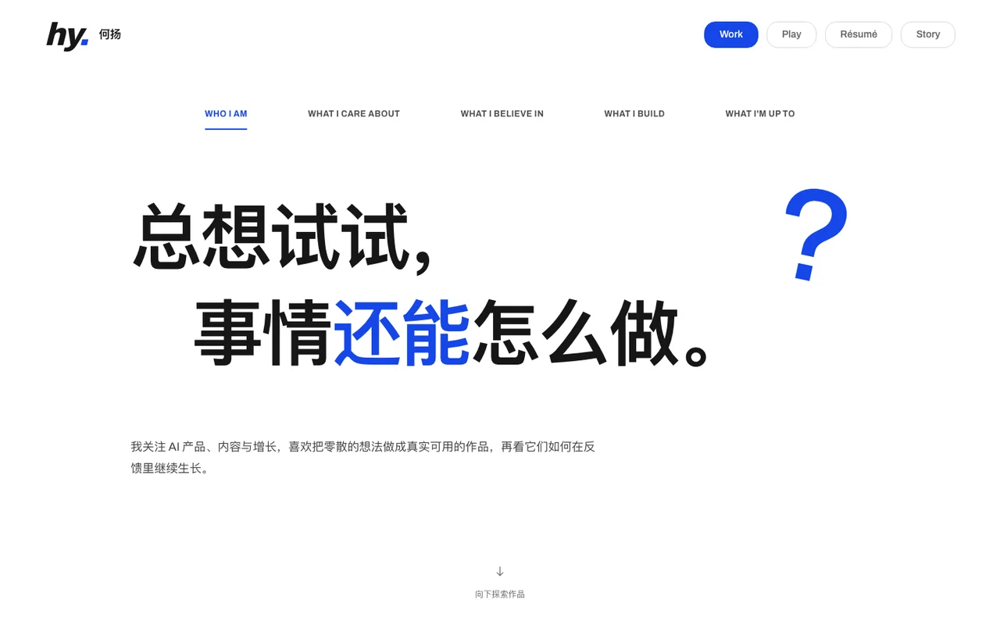
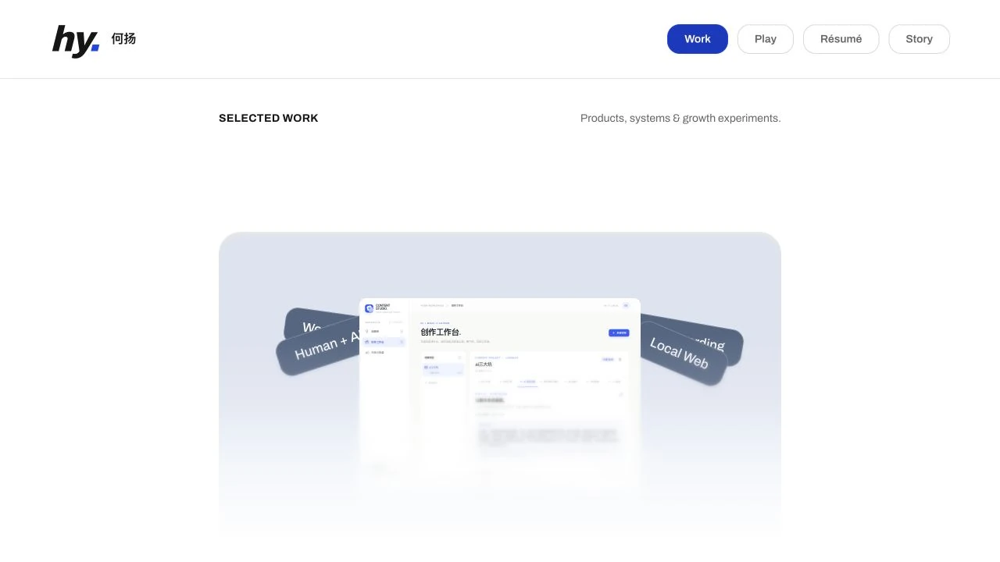

# He Yang — Personal Portfolio

### AI Product · Operations · Growth

总想试试，事情还能怎么做。

一个关于好奇、创意与实践的个人作品集。通过真实项目，展示我如何从发现问题出发，将想法转化为具体的产品与体验。



**[正式作品集 →](https://create.byheyang.cn/)** · [GitHub Pages 预览](https://cocobolo111-png.github.io/personal-portfolio/) · [GitHub 个人主页](https://github.com/Cocobolo111-png)

## About the Portfolio · 通过作品，认识我

我希望访问者不只读到一份经历列表，也能看到我关注什么、怎样理解问题，以及如何把判断落到具体的产品中。

因此，网站用五个可切换的个人章节建立第一印象，再把主要篇幅留给作品。项目案例连接问题、体验、实现与反思，让视觉与交互帮助阅读，而不是替代内容本身。

## Selected Work · 已收录的代表项目

以下三个项目均已出现在当前线上作品集中。案例页介绍产品与实践过程，产品体验入口另行标注。

### TrainTrace

智能训练记录与专业反馈，连接逐组记录、历史对比和下一次训练参考。

[查看案例](https://create.byheyang.cn/work/traintrace) · [GitHub](https://github.com/Cocobolo111-png/TrainTrace-Coach) · [产品体验](https://cocobolo111-png.github.io/TrainTrace-Coach/)

### Love Journal

把日常、影像和重要日期组织成一个可慢慢进入的情侣回忆空间。

[查看案例](https://create.byheyang.cn/work/love-journal) · [GitHub](https://github.com/Cocobolo111-png/love-journal)

### AI Content Growth OS

将内容诊断、版本留存与人工决策整理为可追溯的流程；工具实践持续迭代，尚未证明带来增长效果。

[查看案例](https://create.byheyang.cn/work/ai-content-growth-os)

线上还收录了 AI 视频生产工作台与盘两下，可从 [Selected Work](https://create.byheyang.cn/#work) 继续浏览。案例上线不等于对应产品已公开部署；演示数据、历史材料和真实实现的边界以各案例标注为准。

## Design & Interaction · 让表达有层次

### 白色画布，把重点留给作品

大尺寸黑色文字建立阅读顺序，蓝色强调好奇与关键判断。第一、四章用错位排版与留白完成构图；第二、三、五章通过原创 SVG 路径、实验轨迹与 WIP 模块，呈现我关注体验、动手验证和持续创造的方式。

### 用切换建立自我介绍的节奏

首页通过五个标签，沿着「好奇 → 关注 → 信念 → 创造 → 正在发生」展开自我介绍。点击、键盘方向键及移动端横向滑动均有对应路径；章节切换配合短暂的路径描绘、实验投掷和模块装配动效，并支持系统的减少动态效果偏好。

### 先看作品，再深入过程

Work 用真实项目画面作入口。悬停或键盘聚焦时，图片放大、标签展开，帮助读者从概览进入案例；案例再以章节、图像与必要的演示解释设计取舍。它们是已实现的网页交互，没有将待做的 3D 人物或其他设想当作交付成果。



## Built With · 实现与运行

React、TypeScript、Vite 与自托管 Archivo 字体。动效使用 CSS、Web Animations API 和 requestAnimationFrame，当前未使用 Framer Motion 或 3D 引擎。网站为静态前端，没有后端、数据库或登录服务。

### 本地运行

使用 Node.js **22** 与 pnpm **10**，与现有 GitHub Actions 环境保持一致。

```sh
git clone https://github.com/Cocobolo111-png/personal-portfolio.git
cd personal-portfolio
pnpm install --frozen-lockfile
pnpm dev
```

访问终端显示的地址，无需密钥或外部服务配置。

```sh
pnpm build
pnpm preview
```

构建包含 TypeScript 检查，并为现有案例路由生成静态入口。当前没有独立的自动化测试命令；交互、案例直达与响应式仍需浏览器验收。

### 内容与部署

- `src/data/`：个人文案、项目内容与素材引用。
- `src/sections/`、`src/components/`：首页、作品与案例展示。
- `src/styles/`、`public/`：视觉样式、字体与公开展示素材。
- `scripts/build-pages.mjs`：生成案例直达所需的 HTML 入口。

现有 [GitHub Actions](.github/workflows/pages.yml) 将 `main` 构建并发布到 GitHub Pages，构建时设置 `PORTFOLIO_BASE=/personal-portfolio/`。本地验证同样的路径可使用：

```sh
PORTFOLIO_BASE=/personal-portfolio/ pnpm build
pnpm preview
```

此时预览入口为终端显示地址下的 `/personal-portfolio/`。不要把本地未验收的迭代与文档更新一起发布。

正式站点通过独立的 [生产工作流](.github/workflows/production.yml) 构建到阿里云，由 Caddy 托管静态文件并自动管理 HTTPS。main 合并后自动发布，GitHub Pages 继续作为独立预览环境。部署检查、凭证管理及回滚方法见 [部署文档](deploy/README.md)。

## Project Status · 持续打磨中

当前公开版本包含五章节 Hero、五个项目展示入口及对应案例页。Play、Story 和 Résumé 仍是未开放或未配置的入口，不代表已完成页面或简历下载服务。

当前线上已发布 V0.3 Hero 文案、桌面排版与原创 SVG 视觉升级；README 首页截图同步自这一公开版本。第一、四章的 3D 视觉按计划暂缓，当前以完整的文字构图呈现。`PRODUCT.md` / `DESIGN.md` 保留了阶段性设计记录，部分状态早于当前代码；判断现有能力时，以公开源码与实际页面为准。

项目案例中的合成数据、历史重建与真实素材分别标注，不将工具测试、演示记录或作品展示等同于用户增长和商业成果。
